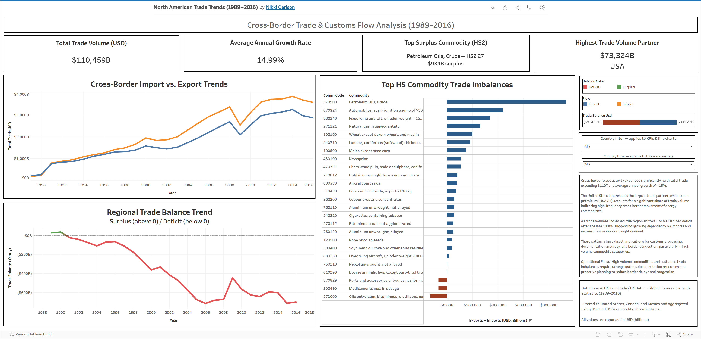

# Cross-Border Trade & Customs Flow Analysis (1989–2016)

## Project Overview

This project examines historical merchandise trade between the United States, Canada, and Mexico from 1989 to 2016 using UN Comtrade data.

The interactive Tableau dashboard explores import and export trends, reported trade values, commodity-level imbalances, and changes in trade patterns over time.

The analysis takes a transportation and logistics perspective, connecting historical trade activity to broader considerations in freight planning, cross-border operations, and customs compliance.

## Business Questions

This analysis focuses on answering:

1. How did reported import and export values change between 1989 and 2016?
2. Which commodities contributed the largest trade surpluses and deficits?
3. How did the combined reported trade balance change over time?
4. Which countries and commodity categories accounted for the highest reported trade values?
5. How can historical trade patterns provide context for freight and cross-border operational planning?

## Dashboard Features

The Tableau dashboard includes:

- **Trade Volume KPIs:** Cumulative reported trade value, compound annual growth rate (CAGR), and highest reported country trade volume.
- **Import vs. Export Trends:** Annual comparisons of reported import and export values.
- **Trade Balance Trends:** Historical changes in aggregate reported trade balances, highlighting periods of surplus and deficit.
- **Commodity Trade Imbalances:** HS6-level comparisons of commodities with the largest positive and negative trade balances.
- **Interactive Filters:** Country and commodity selections for exploring trade patterns.

## Key Findings

- Cumulative reported trade value reached approximately **$110.5 trillion** across the dataset's reporting period.
- The dashboard reports a **10.96% CAGR** for its selected trade measure.
- The United States recorded the highest cumulative reported trade value, approximately **$73.3 trillion**.
- The combined reported trade balance shifted from a small surplus in the early reporting years to persistent deficits in later years.
- Crude petroleum (HS6 270900) showed the largest positive commodity trade balance in the displayed analysis, approximately **$934 billion**.

These findings describe the selected dataset and dashboard calculations, rather than a complete accounting of all trade activity or physical freight movements.

## Operational Relevance

Understanding historical trade patterns can provide useful context for transportation and cross-border logistics.

- **Freight Planning:** Changes in reported trade values can help identify trade growth and commodity concentrations relevant to transportation demand.
- **Customs Awareness:** Commodity classifications and cross-border trade patterns are relevant to understanding the types of shipments involved in international trade.
- **Operational Planning:** Changes in commodity activity and import/export balances may help identify areas for further investigation when evaluating freight movements and resource needs.

The dashboard does not directly measure shipment counts, customs processing times, border congestion, or documentation workload.

## Dashboard Preview

[View Dashboard Screenshot](https://github.com/nkc0686/cross-border-trade-customs-analysis/blob/main/images/North_American_Trade_Trends.png)

## Live Dashboard

[View Interactive Tableau Dashboard](https://public.tableau.com/app/profile/nikki.carlson2355/viz/nafta_17626310339920/NAFTATradeOverview)

## Data Source

**UN Comtrade / UNData — Global Commodity Trade Statistics (1989–2016)**

Dataset filtered to:

- United States
- Canada
- Mexico

Commodity classifications:

- HS2
- HS6

Trade values are denominated in U.S. dollars, with dashboard charts displaying values in billions or trillions as appropriate.

## Tools Used

- Tableau — Interactive dashboard development and visualization
- Kaggle — Dataset access
- Data filtering and preprocessing
- Trade trend and commodity imbalance analysis

## Limitations

- The analysis uses historical data covering 1989–2016 and does not represent current trade conditions.
- Reported monetary trade values are not equivalent to shipment counts, freight tonnage, or border-crossing volumes.
- Import and export reporting may include overlapping trade flows, so cumulative reported values should not be interpreted as unique regional trade activity.
- Trade balances reflect the reporting countries and selected data, rather than a consolidated external trade balance for North America.
- Customs processing times, documentation workload, and border congestion were not directly measured.
- The full source dataset is not included in this repository because of its size.

## Project Purpose

This independent portfolio project combines trade data analysis with practical transportation industry knowledge to explore historical North American trade patterns.

It demonstrates the use of Tableau to organize complex trade data, identify trends, and communicate findings relevant to transportation, logistics, and cross-border operations.
